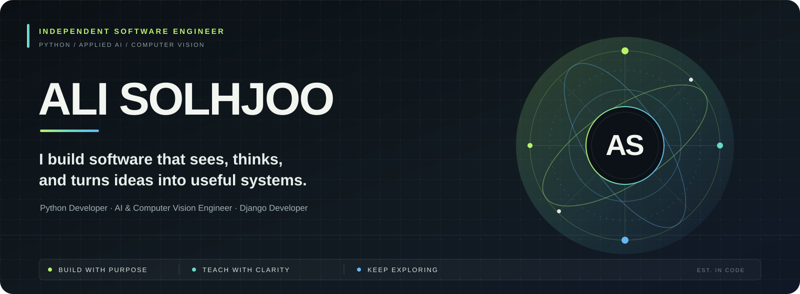

  
    
  <a href="#about">ABOUT</a>&nbsp;&nbsp;·&nbsp;&nbsp;
  <a href="#focus">FOCUS</a>&nbsp;&nbsp;·&nbsp;&nbsp;
  <a href="#selected-work">WORK</a>&nbsp;&nbsp;·&nbsp;&nbsp;
  <a href="#toolkit">TOOLKIT</a>&nbsp;&nbsp;·&nbsp;&nbsp;
  <a href="#teaching">TEACHING</a>&nbsp;&nbsp;·&nbsp;&nbsp;
  <a href="#github-signals">GITHUB</a>&nbsp;&nbsp;·&nbsp;&nbsp;
  <a href="#connect">CONNECT</a>
    
  
  

---

## 01 / The person behind the code

I'm **Ali Solhjoo** — a Python-focused software developer, AI and computer vision engineer, Django developer, and programming instructor.

I work where **software engineering meets intelligent systems**. I enjoy building practical applications, exploring how machines interpret visual information, and turning complex ideas into tools people can actually use.

My approach is simple: understand the problem, build the smallest useful solution, improve it with care, and share what I learn.

<table>
  <tr>
    <td align="center" width="33%">
      <strong>4+ years</strong> 
      Programming experience
    </td>
    <td align="center" width="33%">
      <strong>2+ years</strong> 
      Teaching experience
    </td>
    <td align="center" width="33%">
      <strong>300+ learners</strong> 
      Students taught
    </td>
  </tr>
</table>

## 02 / What I work on

<table>
  <tr>
    <td width="50%" valign="top">
      <h3>01 · Applied AI &amp; Computer Vision</h3>
      
Image understanding, visual detection, object tracking, and practical computer-vision workflows.

    </td>
    <td width="50%" valign="top">
      <h3>02 · Backend &amp; Product Engineering</h3>
      
Python and Django applications, backend logic, and web products designed around real needs.

    </td>
  </tr>
  <tr>
    <td width="50%" valign="top">
      <h3>03 · Automation &amp; Software Tools</h3>
      
Python-powered utilities, repeatable workflows, and software that removes unnecessary manual work.

    </td>
    <td width="50%" valign="top">
      <h3>04 · Teaching &amp; Technical Communication</h3>
      
Project-based learning in Python, Django, and AI — making technical ideas easier to understand and apply.

    </td>
  </tr>
</table>

  

## 03 / Selected work

A few public repositories that show how I explore software — from computer vision to practical desktop applications. Each link opens the source repository.

<table>
  <tr>
    <td width="50%" valign="top">
      <h3><a href="https://github.com/AliSolhjoo/People-Counter">People Counter</a></h3>
      
<strong>Computer Vision · Detection · Tracking</strong>

      
Detects people in video frames with OpenCV DNN and MobileNet-SSD, then assigns object IDs with a centroid-based tracker.

      

        
        
        
      

    </td>
    <td width="50%" valign="top">
      <h3><a href="https://github.com/AliSolhjoo/Open-CV-Project">Face Detection with OpenCV</a></h3>
      
<strong>Computer Vision · Webcam</strong>

      
A webcam-based face-detection experiment using OpenCV and a Haar Cascade classifier.

      

        
        
      

    </td>
  </tr>
  <tr>
    <td width="50%" valign="top">
      <h3><a href="https://github.com/AliSolhjoo/Restaurant-Management-System">Restaurant Management System</a></h3>
      
<strong>Python · Desktop GUI</strong>

      
A Tkinter order-management interface with customer details, menu quantities, bill preview, and order totals.

      

        
        
      

    </td>
    <td width="50%" valign="top">
      <h3><a href="https://github.com/AliSolhjoo/For-Ai-Class">AI Class Resources</a></h3>
      
<strong>Learning · Visual Computing</strong>

      
Visual learning materials and computer-vision examples, including eye-detection resources for practical demonstrations.

      

        
        
      

    </td>
  </tr>
</table>

## 04 / Toolkit

The tools I use most often across development, applied AI, and teaching.

**Languages &amp; web**

  
  
  
  
  

**Frameworks, AI &amp; data**

  
  
  
  
  

**Developer workflow**

  
  

## 05 / Teaching is part of my engineering

I teach **Python, Django, and Artificial Intelligence** with a practical, project-first approach. I believe a concept becomes valuable when a learner can use it to build something independently.

- **300+ students** taught through programming education.
- **2+ years** of teaching experience.
- Focus on clear explanations, hands-on exercises, and complete small projects.

I don't just want to show how code works — I want learners to understand *why* it works and how to use that knowledge to solve new problems.

## 06 / GitHub signals

  
  
   
  
  Live cards reflect activity and languages visible to GitHub's public profile endpoints.

## 07 / Let's build something useful

I'm open to meaningful conversations and collaborations around **Python, Django, applied AI, computer vision, automation, and programming education**.

The best projects start with a clear problem and people who care about solving it well.

  
  
    
  
    
  Designed with intention. Built with code. Improved one commit at a time.

